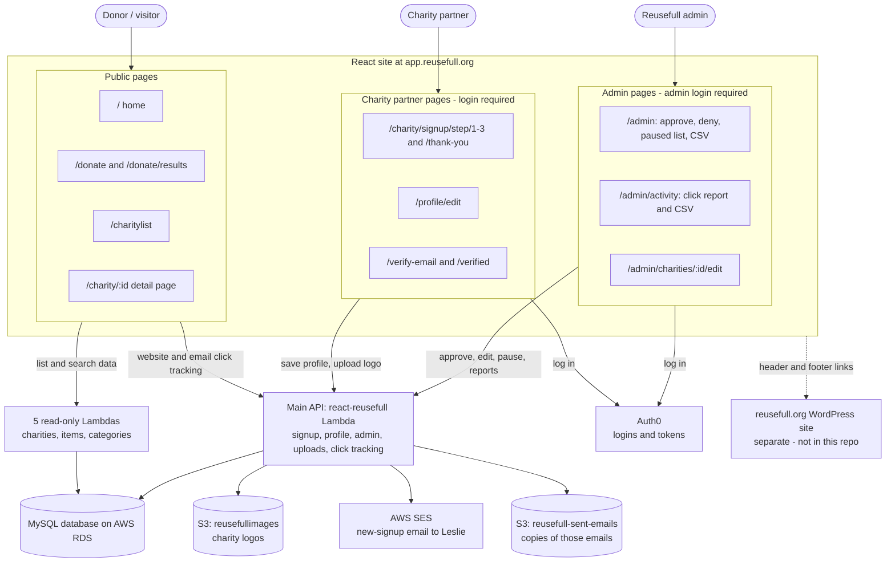
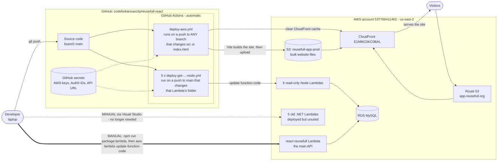

# Reusefull: how everything fits together

*Checked against the live AWS account, DNS and this repo on 2026-11-22. If something here disagrees with what you see in AWS or GitHub, trust AWS/GitHub and fix this page.*

## 1. The short version

There are **two separate websites** under the Reusefull name:

| | What it is | Where its code lives |
|---|---|---|
| **reusefull.org** | The WordPress marketing site (About, Blog, FAQs…) | **Not in this repo.** Runs on a server outside AWS (`104.207.139.74`, nginx). Managed in the WordPress admin. |
| **app.reusefull.org** | The donation-matching web app: charity list, donate search, charity sign-up, admin console | **This repo**: <https://github.com/codeforkansascity/reusefull-react> |

Everything for `app.reusefull.org` is in this one GitHub repo. It has three kinds of code:

1. **The front end** (`src/`, plus `index.html`, `vite.config.ts`): a React site. It is built into plain files and served from AWS.
2. **One main API** (`reusefull-api/`): runs as an AWS Lambda. Anything that logs in, saves data, uploads a logo, sends email or powers the admin screens goes through it.
3. **Five small read-only APIs** (`Lambdas/*Node/`): AWS Lambdas that just fetch the lists the public pages show (charities, item types, categories).

They all share **one MySQL database** (AWS RDS). **Auth0** handles logins. Charity logos live in **S3**. New-signup emails go out through **AWS SES**.

**What Vite is:** the tool that builds the front end. `npm run dev` runs a local test copy at `localhost:5173`; `npm run build` produces the static files in `dist/` that get uploaded. It does not run on the live site.

## 2. Where everything lives

AWS account **537766411402**, region **us-east-2 (Ohio)**. On Rob's computer the AWS profile for it is `reuse-robkraft`.

| Piece | Source code | Where it runs | How it gets deployed |
|---|---|---|---|
| **Front end** (the app.reusefull.org site) | `src/`, `index.html`, `vite.config.ts` | S3 bucket `reusefull-app-prod` → CloudFront distribution `E1M8IC0KC0BAL` → `app.reusefull.org` | **Automatic**: GitHub Action `deploy-aws.yml` |
| **Main API** | `reusefull-api/` | Lambda `react-reusefull` (Node 22). URL: `https://6z3jejdqlqa47knjz6atr6edqy0kgkzt.lambda-url.us-east-2.on.aws` | **Manual**: see section 5 |
| **Read-only Lambdas** (5, Node 20) | `Lambdas/GetOrgsNode`, `GetOrgItemsNode`, `GetOrgTypesNode`, `GetCharityTypesNode`, `GetItemTypesNode` | One Lambda each (URLs below) | **Automatic**: one GitHub Action per Lambda |
| **Old .NET Lambdas** (5) + `FunctionHandler` | `Lambdas/GetOrgs`, `GetOrgItems`, `GetOrgTypes`, `GetCharityTypes`, `GetItemTypes` | Still deployed in AWS, but **the site does not call them** | Manual (Visual Studio). Safe-to-retire candidates; check first |
| **Database** | No migration files. A structure-only copy for local testing is in `docs/local-dev-schema.sql` | RDS MySQL 8.4 instance `reusefull` | Changed by hand. The main API creates a few tables/columns itself on first use (`reusefull-api/src/db.ts`) |
| **Logins** | n/a | Auth0 tenant `reusefull.us.auth0.com` (a separate dev tenant, `dev-t2ekjt0w2o6oaw2q`, appears only in local config) | Auth0 dashboard |
| **Charity logos** | n/a | S3 bucket `reusefullimages` | Uploaded by the main API via short-lived signed links |
| **Email** | `reusefull-api/src/email.ts` | AWS SES (domain `reusefull.org` verified, sends from `hello@reusefull.org`); copies of each email saved to S3 bucket `reusefull-sent-emails` | SES console |
| **DNS** | n/a | Route 53 zone `reusefull.org`: `app` → CloudFront; the bare domain and `www` → the WordPress server; Google Workspace mail records; SES verification records | AWS console |
| **Source control + automation** | n/a | GitHub repo `codeforkansascity/reusefull-react`, Actions tab | n/a |

The five read-only Lambdas the site calls (hard-coded in `src/api/queries/` and `src/utils/request.ts`):

| Lambda | URL |
|---|---|
| GetOrgsNode (list of charities) | `https://4e67jwa7xlurv6riekrumne5h40ssntr.lambda-url.us-east-2.on.aws` |
| GetOrgItemsNode (which charity accepts which items) | `https://mbgtl54izbhjckuzhrhjijaaga0lzirw.lambda-url.us-east-2.on.aws` |
| GetOrgTypesNode (charity categories per charity) | `https://o6zpi54q3u247x73qsckjxesay0ibtke.lambda-url.us-east-2.on.aws` |
| GetCharityTypesNode (list of categories) | `https://4zm4kqhbosmorygtjwdanxrpqe0imbml.lambda-url.us-east-2.on.aws` |
| GetItemTypesNode (list of item types) | `https://kudlj6hfqxkm327mdrzrmx6rri0gvomt.lambda-url.us-east-2.on.aws` |

**Unclear / looks unused (verify before deleting):** S3 bucket `reusefull.org` and CloudFront distribution `E3NMQZLU3RRMNL` (no domain name attached); the Lambda `FunctionHandler` (no URL); `netlify.toml` (the Netlify deploy was removed from CI); stray files in the repo root such as `test.txt`.

## 3. Diagram 1: the site

What each kind of person uses, and which back-end piece each page talks to.



## 4. Diagram 2: how it is deployed

Solid arrows happen **automatically** when code is pushed to GitHub. The thick arrow is a **manual** step someone has to run by hand.



The WordPress site (`reusefull.org`) is not part of this picture: it is deployed separately and its code is not in this repo.

## 5. How to deploy each piece

### Front end: automatic
Push (or merge) to GitHub. If the change touches `src/**` or `index.html`, the **Deploy to AWS (S3 + CloudFront)** action builds the site with Vite and publishes it. Watch it on the repo's **Actions** tab; the site updates within a few minutes.

- The build uses the `VITE_*` values stored as **GitHub secrets**, not your local `.env`. A local `.env` only affects `npm run dev`.
- **Careful:** this action has no branch filter, so a push to *any* branch that touches `src/**` deploys to production.

### Read-only Lambdas: automatic
Push to `main` with a change inside `Lambdas/<Name>Node/`. That Lambda's own action packages and uploads it.

### Main API (`reusefull-api`): manual
Nothing deploys this automatically, so what's on GitHub can differ from what's live. Check the Lambda's *Last modified* time in AWS to see when it last shipped.

```bash
cd reusefull-api
npm run package:lambda        # builds and zips to lambda.zip
aws lambda update-function-code \
  --function-name react-reusefull \
  --zip-file fileb://lambda.zip \
  --region us-east-2 \
  --profile reuse-robkraft
```

If `lambda.zip` comes out tiny (a few KB) or missing on Windows, the zip step failed on a locked file. Re-zip the already-built `.lambda_pkg` folder in PowerShell:

```powershell
Add-Type -AssemblyName System.IO.Compression.FileSystem
[System.IO.Compression.ZipFile]::CreateFromDirectory("$PWD\.lambda_pkg", "$PWD\lambda.zip", [System.IO.Compression.CompressionLevel]::Optimal, $false)
```

Then confirm it is live: open `https://6z3jejdqlqa47knjz6atr6edqy0kgkzt.lambda-url.us-east-2.on.aws/health`; it should say `ok`. Errors from the API are written to CloudWatch log group `/aws/lambda/react-reusefull`.

### Everything else: by hand in a console
There is no automation, and no copy in the repo, for these. Changes are made in the service's own dashboard:
- **DNS:** AWS Route 53
- **CloudFront and S3 settings:** AWS console
- **Logins:** the Auth0 dashboard
- **Email sending:** the AWS SES console
- **Database structure:** directly on the MySQL database

## 6. Accounts and secrets: what exists and where (names only, no values)

| Where | What is stored there |
|---|---|
| **GitHub repo secrets** | `AWS_ACCESS_KEY_ID`, `AWS_SECRET_ACCESS_KEY`, `AWS_REGION`, `S3_BUCKET`, `CLOUDFRONT_DISTRIBUTION_ID`, `VITE_API_BASE_URL`, `VITE_AUTH0_DOMAIN`, `VITE_AUTH0_CLIENT_ID`, `VITE_AUTH0_AUDIENCE` |
| **Settings on the `react-reusefull` Lambda** (AWS console → Lambda → Configuration → Environment variables) | `DB_HOST`, `DB_PORT`, `DB_NAME`, `DB_USER`, `DB_PASSWORD`, `AUTH0_DOMAIN`, `AUTH0_AUDIENCE`, `CORS_ORIGIN`, `S3_BUCKET`, `ACTION_SHARED_SECRET` |
| **Auth0 dashboard** | Login application and the API definition for the front end, tenant `reusefull.us.auth0.com` |
| **AWS IAM** | The users and keys that can deploy; the Lambdas' own permission role is `2024LambdasToCallRDS` |

## 7. Things worth knowing

- **Deploys are mixed:** the front end and 5 read-only Lambdas deploy automatically, but the main API does not. Forgetting to deploy it is the easiest way for the live site to be missing a fix.
- **The database is reachable from the internet** (RDS "publicly accessible" is on). The only protection is its security group and password; worth tightening.
- **The main API connects with a fixed database password** stored in its Lambda settings, while the five read-only Lambdas use temporary AWS-issued login tokens.
- **The front end hard-codes the five read-only Lambda URLs.** If one of those Lambdas is ever recreated its URL changes and the code must be edited.
- **There is no real migration history.** `docs/local-dev-schema.sql` is a one-time snapshot of the table structure (no data) for local testing; production changes are still made by hand, so that snapshot can drift.
- **Dead weight:** the five .NET Lambdas, `FunctionHandler`, `netlify.toml`, and the unclear bucket and CloudFront distribution listed in section 2.

For local setup, see the [README](../README.md). `docs/ARCHITECTURE.md` has older, more detailed diagrams of the data flow and caching.
